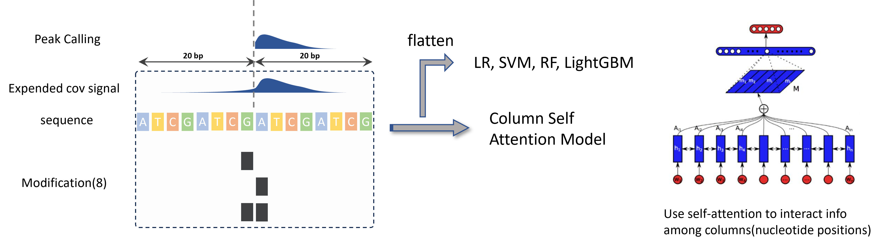

#  Truncated_Peaks_Classifier_demo

## Introduction

Version: 0.1 2024/12/10

Author: Zhang Yusa

Truncated_Peaks_Classifier_demo: The demo version of a serious machine learning  models to identify if a peak has been interrupted due to modifications  during a normal sRNA NGS  data analysis.

## Graphic Abstract



## Dataset Constrcytion


## 🔧 Installation and quick start

Run the commands below from the root of a clone of this repository. Paths such as `path/to/full_feature/samples` are placeholders that must be replaced with actual input locations.

Use Python 3.10 or later in a separate environment:

```bash
git clone https://github.com/zhangysTHU/truncated_peak_classifier_demo.git
cd truncated_peak_classifier_demo
python -m venv .venv
```

Activate the environment with `.venv\Scripts\activate` on Windows, or `source .venv/bin/activate` on Linux/macOS.

For figure regeneration only:

```bash
python -m pip install -r requirements-figures.txt
python figures/S6/plot_fig_s6.py
```

The plotting dependencies are NumPy 1.26.4, pandas 2.3.3, and Matplotlib 3.10.8. The default command writes five PDF and five SVG panels to `figures/S6/output/` without training any model.

For training, inference, and notebook analyses:

```bash
python -m pip install -r requirements.txt
```

Install JupyterLab separately if an interactive notebook interface is needed:

```bash
python -m pip install jupyterlab
jupyter lab
```

## Requirments for repeat this work

- python

  ```
  python: 3.10.12
  numpy: 1.26.4
  pandas: 2.2.1
  lightgbm: 4.5.0
  sklearn: 1.4.1.post1
  joblib: 1.3.2
  matplotlib: 3.8.3
  IPython: 8.14.0
  torch: 2.2.2+cpu
  seaborn: 0.13.2
  ```

## Repository contents

```text
truncated_peak_classifier_demo/
├── figures/S6/
│   ├── plot_fig_s6.py
│   ├── source_data/                 # Model metrics and ablation feature maps
│   └── output/                      # S6B–F PDF/SVG panels
├── ablations/
│   ├── outputs/                     # Recorded manuscript ablation tables
│   └── python_scripts/              # Attention and LR ablation notebooks
├── training_notebooks/
│   ├── load_data.py                 # Shared sample/label alignment and validation
│   ├── DLmodels/train_attention.py  # Fixed-epoch attention training
│   ├── MLmodels/                    # LR, SVM, RF, and LightGBM training
│   └── plot/                        # Existing attention/coverage plotting notebooks
├── TCGA_peaks_prediction/
│   ├── cross_attention.py           # Shared row-column attention architecture
│   └── predict.py                   # Validated checkpoint-based inference
├── prepared_samples/               # Bundled partial-feature demonstration matrices
├── sample_preprocessing/           # Original feature-preparation scripts
├── resources/                      # Existing processed resources and sample lists
├── saved_models/                   # Recorded model files and evaluation reports
├── legacy/                         # Superseded experimental/plotting notebooks
├── tests/test_publication.py
├── requirements-figures.txt
├── requirements.txt
└── LICENSE
```

